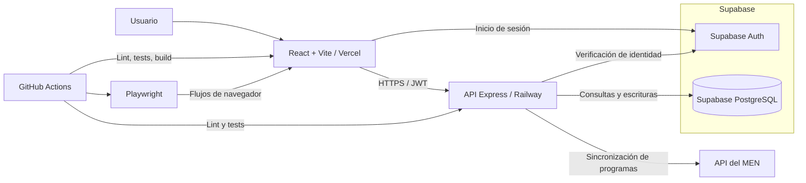

# Arquitectura lógica de Brota

Corte: 24 de noviembre de 2026. Diagrama del sistema actual, no de la infraestructura objetivo.

## Responsabilidades

- React: presentación, navegación, formularios y sesión del usuario.
- Express: reglas de negocio, autorización, perfiles, comunidad, recomendaciones, administración e integración MEN.
- Supabase: autenticación, persistencia relacional y políticas de acceso. La clave de servicio pertenece exclusivamente al servidor.
- GitHub Actions: controles de calidad de los PR; Playwright verifica flujos del navegador. La integración con la BD local se ejecuta por separado (ver plan de pruebas).

## Entornos

Producción/beta: Vercel, Railway y Supabase remoto. Pruebas: Supabase local mediante Docker y migraciones; no escribir en producción. El diagrama de despliegue objetivo se mantiene en [guia_deploy.md](guia_deploy.md).

Referencias: [contexto técnico](CLAUDE.md), [modelo de datos](modelo_datos.md), [plan de pruebas](plan_pruebas.md).
